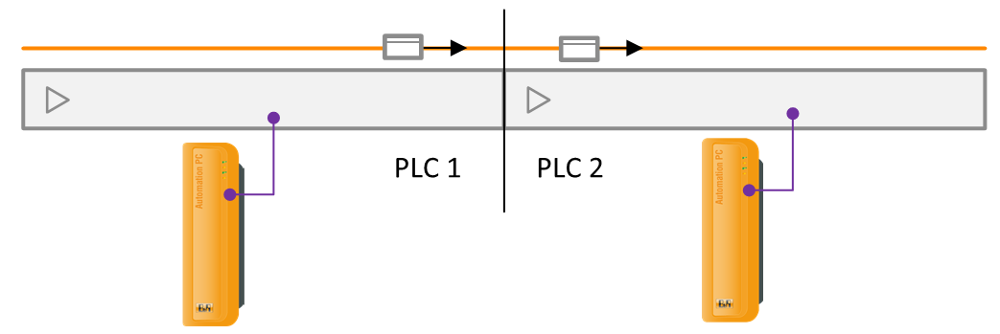

# ACOPOStrak Shuttle Handover Demo

This B&R Automation Studio project demonstrates a shuttle handover between two PLC-controlled ACOPOStrak assemblies. The sender prepares and deletes a shuttle from its assembly, while the receiver uses the handover data to add it to the receiving assembly.

## Project Structure

- `Demo.apj` - Automation Studio project file.
- `Logical/Send` - Sender program using `TSH_AsmSendShuttleDelete`.
- `Logical/Receive` - Receiver program using `TSH_AsmReceiveShuttleAdd`.
- `Logical/Libraries/TrakShHo` - Handover function blocks and supporting types.
- `Physical/Send` and `Physical/Receive` - Hardware configurations for the two PLCs.

## TrakShHo: The Handover Core

The `TrakShHo` library is the heart of this project: it contains the reusable logic that coordinates the shuttle handover between the two assemblies. On the sender side, `TSH_AsmSendShuttleDelete` reads the shuttle data, transfers it to the receiver, and deletes the original shuttle only after the receiver confirms the handover. On the receiver side, `TSH_AsmReceiveShuttleAdd` uses that data to create a shuttle, confirms the transfer, and moves the new shuttle toward its configured target.

The library also handles the handover state machine, communication monitoring, error handling, recovery, and logging. The Send and Receive programs shown here provide the application-specific configuration and cyclic calls around these function blocks; the handover process itself is implemented in `TrakShHo`.

The Send and Receive programs exchange handover data through their respective function-block interfaces. Both are configured for standalone simulation with ARsim.

## Requirements

- B&R Automation Studio 6.7 or a compatible version.
- The B&R technology packages and libraries required by the project, including mapp Motion and the ACOPOStrak handover components.
- ARsim for standalone simulation.

The project metadata specifies mapp Motion 6.8.0. Installed package versions and target hardware may affect whether the project can be built or simulated without adjustments.